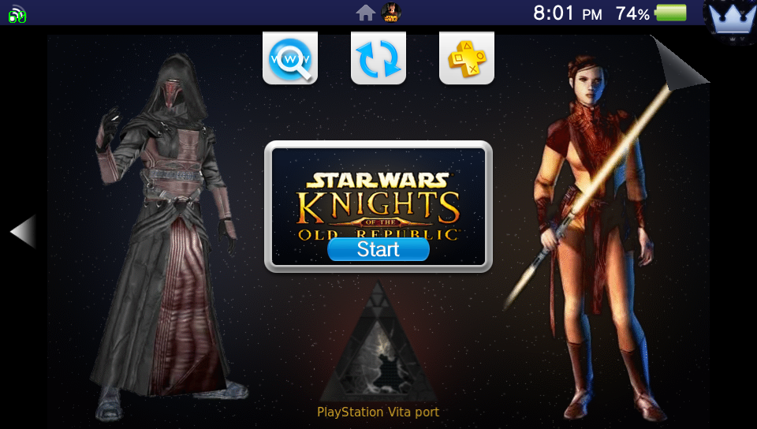
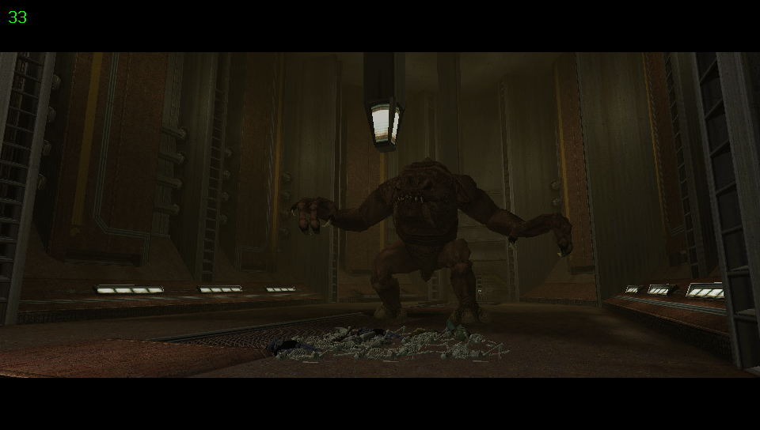

# VitaKotor

**Star Wars: Knights of the Old Republic on the PlayStation Vita.**

A native Vita port of the *Android* release of KOTOR, built with the so-loader
technique: rather than reimplementing the game, the loader loads Aspyr's own ARM
libraries straight from your copy of the Android build, resolves everything they
import against Vita equivalents, and hands control to the game's real entry
point. Graphics run through [vitaGL](https://github.com/Rinnegatamante/vitaGL),
with a from-scratch FMOD audio implementation over `sceAudiodec` and
`sceAudioOut` underneath.

> **You must own the Android version of KOTOR.** Nothing here contains game
> code or data — only the loader, plus artwork used for the LiveArea. It does
> nothing on its own. You supply the game.

## Screenshots

<p align="center">
  
  
</p>

---

## Status

**The full game is playable.** The unmodded game has been played from start
to finish on a Vita, through every planet to the ending.

Combat, dialogue, inventory, containers, cutscenes and saves all work, and it
looks and sounds like the game. What remains is frame rate in busy areas and a
few rough edges. One rare crash has been seen, and no save has been lost. See
[Known issues](#known-issues). Save regularly all the same.

| | |
|---|---|
| Startup | ~2 min on first launch, then under a minute |
| Area loads | Under a second to load; the loading screen then stays up 15–20 s while textures upload |
| Frame rate | Locked to 30 fps; holds it in most areas with Grass, Shadows and Frame Buffer off (see [Graphics settings](#graphics-settings)); dense scenes dip to ~20 |
| Playthrough | Completed start to finish, unmodded |
| Audio | Effects, voice and music all work |
| Cutscenes | Every movie checked: all play with sound; tap or press a button to skip |
| Input | Touchscreen, sticks and buttons — see [Controls](#controls) |
| Saves | Work, stored on the Vita |
| Mods | Work — KOTOR 1 Restoration plus six more played together; see [Mods](#mods) |

`main` is usually ahead of the newest [release](../../releases); the issue list
below says which fixes have not been released yet.

---

## Requirements

**On the Vita**

- A Vita or PS TV on firmware that can run [HENkaku](https://henkaku.xyz/) / taiHEN
- [`kubridge.skprx`](https://github.com/bythos14/kubridge/releases) installed as a taiHEN plugin
- `libshacccg.suprx` in `ur0:data/` — the runtime shader compiler. Use
  [this installer](https://github.com/Rinnegatamante/vita-shacccg-installer) if
  you don't have it. Without it the game stops at launch with a message
  saying so.
- Roughly **2.7 GB** free on `ux0:`

**From your own copy of the game**

The Android release: the `.apk` and both `.obb` expansion files. An `.apk` is
just a zip — open it with any archive tool to get at the libraries inside.

**Which APK versions work?**

| APK | Status |
|---|---|
| **1.0.10** | Works — the version this port was built on |
| **1.0.9 build 54** | Works — its libraries are identical to 1.0.10's |
| **1.0.7 / 1.0.71** | Works — tested on hardware: menus, saves, movies, sound, MODS |
| **1.0.9 Amazon Underground** | **Does not work** — an older build with a different audio engine |

To tell them apart, look inside `lib/armeabi-v7a/` in the APK: if it has
`libfmod.so` it works; if it has `libfmodex.so` and `libgnustl_shared.so`
instead, it is the Amazon Underground build. With the repository checked out,
`python3 tools/check_apk.py yourfile.apk` reports whether the loader has
everything a given APK needs.

---

## Installation

1. **Install `KOTOR.vpk`** — from [Releases](../../releases) — with VitaShell.

2. **Create `ux0:data/kotor/`** on your Vita.

3. **Copy four libraries** out of your APK, from `lib/armeabi-v7a/`:

   ```
   libKOTOR.so
   libandroid_port.so
   libminiz.so
   libLzmaLib.so
   ```

4. **Copy both expansion files**, renaming them exactly:

   ```
   main.<version>.com.aspyr.swkotor.obb   ->  main.obb    (~2.1 GB)
   patch.<version>.com.aspyr.swkotor.obb  ->  patch.obb   (~453 MB)
   ```

5. **Launch it.** The **first** boot takes around two minutes: it reads through
   the 2.1 GB archive and records what it needed into `main.obb.idx` beside it.
   Every boot after that reuses the recording and reaches the game in under a
   minute. A progress bar is on screen throughout, so you can tell it is
   working rather than hung.

   Delete the `.idx` files if you ever replace an `.obb`; they are rebuilt
   automatically, and a mismatched one is ignored rather than trusted.

You should end up with:

```
ux0:data/kotor/
├── libKOTOR.so
├── libandroid_port.so
├── libminiz.so
├── libLzmaLib.so
├── main.obb
└── patch.obb
```

The loader adds `main.obb.idx`, `patch.obb.idx`, `startup.tim` and `log.txt`
here on first run.

Shaders and font metrics ship inside the VPK, so there is nothing else to copy.

---

## Graphics settings

**For a steady frame rate, leave Grass, Shadows and Frame Buffer off** in the
game's graphics options. With all three off, Dantooine holds a near-constant
30 fps. With them on it drops to about 18 fps, and grass also stutters as you
walk, while the game rebuilds it around you. High quality is fine to leave on.

The port reads a few settings of its own from `ux0:data/kotor/swkotor.ini`.
Add a `[Vita Options]` section at the end of the file:

```ini
[Vita Options]
FrameLock=30
GrassWind=0
```

| Key | Default | What it does |
|---|---|---|
| `FrameLock` | `30` | Frame rate cap. At 30 every frame stays on screen for the same time, so motion is even. `20` for a lower, steadier cap; `0` unlocks it (up to 40 fps, but frames alternate between two and three screen refreshes and motion judders) |
| `GrassWind` | `0` | `1` makes the grass sway again, at a CPU cost every frame |
| `DrawDistance` | `0` | Caps how far you can see, in metres, in areas that have fog. It made no measurable difference on Dantooine, so it is off |
| `ObbCacheKB` | `8192` | RAM kept for recent reads from the game's archives |
| `TextureBits` | `16` | `32` loads textures at full colour depth: sharper, about the same speed, but it can use up the Vita's video memory in big areas. Also selectable from the **MODS** button |

## Controls

KOTOR's native Android gamepad path is mapped to the Vita controls. The left
stick moves, the right stick controls the camera, the D-pad navigates, and the
face buttons follow the familiar layout: Cross accepts, Circle cancels, Square
is X, and Triangle is Y. L and R are the shoulder actions; Start opens the
game's pause path. Select is currently reserved.

The front touchscreen works too, and you can mix it freely with the buttons:
tap menu items, dialogue choices and the on-screen combat buttons directly.
Some actions, like a normal attack, are easiest to reach by touch, since the
Vita has no L2/R2 for the Android layout's triggers. The rear touch panel is
off, so holding the console never taps anything.

**Typing a name** — your character's, or a save's — opens the Vita's on-screen
keyboard. Select the name field and confirm to bring it up, then type and accept.

## Language

The game ships its text in five languages, and the Android release picked one
from the phone's locale. There is no locale to read on the Vita, so the port
asks you instead.

**The first time you run it**, a short list comes up before the loading screen:

```
                       CHOOSE A LANGUAGE

                         > ENGLISH
                           FRANCAIS
                           ITALIANO
                           DEUTSCH
                           ESPANOL
```

Up and down to move. The bottom of the screen names the buttons — confirm is
whichever button your console uses to confirm, and the other one leaves things
alone. Your choice is saved and you are not asked again. **To change it later,
press L while the game is starting** — any time from launching it until the
loading screen appears, while the screen is still black — and the list comes
back.

The choice is written to `ux0:data/kotor/swkotor.ini`, and you can equally set
it there by hand:

```ini
[Game Options]
Language=fr
```

`en` (the default), `fr`, `it`, `de` and `es`. Anything else, or no line at all,
gives you English. If the section is not in your ini yet, add it.

This changes the on-screen text and the main-menu artwork. **Voice-over stays
English** in every language — the game data only ever shipped one set of
recordings, so this is what the retail releases did too.

### Fan translations

Unofficial translations show up in the same list, below the five built-in
languages. Give each one its own folder:

```
ux0:data/kotor/translations/Polski/tv_dialog.tlk
```

The folder name is what the list shows, so name it after the language. The
file inside can be called `tv_dialog.tlk` or `dialog.tlk`; either works. Then
**press L while the game is starting** and pick it. The choice is saved as
`Translation=Polski` next to `Language=` in `swkotor.ini`, and choosing one of
the built-in languages again switches it off.

Don't repack the OBB files, and don't edit them. The card folder is read first.

Things to know:

- A translation runs as English underneath, so the **main-menu buttons stay in
  English**: they are pictures, not text. The boot-screen tips use the
  translation's text.
- The game's fonts only have Western European letters. Accented Latin text
  (Portuguese, Polish without ł/ś/ż, and so on) shows up; Cyrillic and other
  scripts show up as the wrong letters and are not supported.
- The game's own text tables all have 49,265 entries. The log says how many
  entries your file has (`ux0:data/kotor/log.txt`, look for `[tr]`). If the
  numbers differ, the file was made for another edition of the game, and
  some lines may be missing or in the wrong place.

## Mods

The game checks the memory card before the OBB files. Any file you put in the
right folder replaces the game's own file with the same name. You don't need
to repack or edit the OBBs, and you shouldn't.

Each mod setup is a folder in `ux0:data/kotor/mods/`:

```
ux0:data/kotor/mods/
└── Restoration/
    ├── tv_dialog.tlk    <- a mod's dialog.tlk, renamed (see below)
    ├── override/        <- loose files: .2da, .tga, .tpc, .utc, .dlg, .ncs ...
    ├── modules/         <- .mod files
    ├── lips/
    └── streamwaves/
```

The main menu's Google Play button is a **MODS** button on the Vita. Press it
and the game restarts into a list with **VANILLA** first, then every folder in
`mods/`. Pick one and the game starts with it; the choice is remembered. A set
only needs the files its mods change. Everything else comes from the OBB.
A second list then asks for texture quality: 16-bit (faster) or 32-bit
(sharper). That choice is saved too.

- The Android game is the **controller** version of KOTOR. It reads
  `tv_dialog.tlk`, not `dialog.tlk`, so rename a mod's `dialog.tlk`.
- **Saves are shared** between sets. A save made with a mod may not load
  properly without it.
- Start a new game after installing a mod that changes areas or the story.
  That is the usual KOTOR advice on PC too.
- The same folders directly in `ux0:data/kotor/` also work, and apply to
  every set, VANILLA included.

### What works

Each of these was checked on a Vita:

- **Loose files in `override/`** replace the game's textures, 2DA tables and
  other resources. That includes files packed inside the game's texture packs
  and data archives.
- **`.mod` files in `modules/`** replace the game's own version of that area.
- **A modded talk table** (`tv_dialog.tlk`) with lines added at the end.
- **KOTOR 1 Restoration 1.2**, all options, played through the first areas.

### Installer mods (TSLPatcher / HoloPatcher)

Most big mods come with an installer that edits the game's files instead of
just adding new ones. The installer can't run on a Vita, so you have to run
it on a PC first:

1. Run the installer on a PC copy of KOTOR (version 1.03).
2. Copy what changed into a mod set on the Vita: `Override/` into
   `override/`, the new `.mod` files into `modules/`, and `dialog.tlk` as
   `tv_dialog.tlk`.

Patching a PC install like this is untested. The Restoration build that was
tested was patched against the Android game's own files instead.

### What doesn't work, or hasn't been tested

- **Mods that patch `swkotor.exe`** (widescreen or high-resolution menus,
  4 GB patches and so on) can't work. There is no `.exe` on the Vita.
- **Repacking the OBBs.** The game freezes. Use the folders above.
- **`.dds` textures** haven't been tested on a Vita.
- **Replacement movies (`.bik`)** haven't been tested.
- **Mods built for the PC talk table may show keyboard prompts** where the
  controller version would name a button.
- **Combining several installer mods** hasn't been tried. Install them in the
  order each mod asks for, on the PC side, before copying anything across.

If a mod misbehaves, attach `ux0:data/kotor/log.txt` to the report and name
the mod and its version.

## Known issues

### Intermittent

It can't be reproduced on demand and doesn't cost you a save. It is listed
because you may hit it. Save regularly.

- **Rare crash right after an area-change auto-save.** Once, leaving the
  Leviathan, the game crashed while unloading the old area. The auto-save had
  already finished, so nothing was lost. It looks like a freeze because the
  crash handler parks the app. Relaunch and load; the same exit worked on the
  next try. If it happens to you, please send `log.txt`.

### Rough edges

- **Frame drops.** With the 30 fps lock and the heavy graphics options off,
  slow frames are rare (about one per 120 frames on Dantooine, down from 15).
  The ones that remain are inside the game's own code. Grass, Shadows and Frame
  Buffer bring them back; see [Graphics settings](#graphics-settings).
- **Voices over the loading screen.** The game starts running as soon as the
  area data is in, while the loading screen is still up for the texture upload,
  so the new area's sounds and conversations can start before you see it. Once,
  after dying and reloading, a line from the fight that killed you played over
  the loading screen; that one is being traced.
- **Some shiny armour looks off.** Reflective materials can shine too strongly
  or with a colour tint, and Sith armour can turn a bright solid colour (green
  has been seen) that changes from one area to the next. Each area loads its
  own reflection maps, and which of them goes wrong is being traced.
- **Busy areas run at around 20 fps.** The Lower City holds the 30 fps lock,
  while the Upper City and the Undercity sit near 20 with a crowd on screen. Most
  of that frame time is the game's own rendering code on one CPU core,
  preparing several hundred objects a frame; the graphics chip is not the
  limit. Since v0.5.0 the GL calls themselves run on a second core, which took
  about a tenth off each busy frame; what is left is the game's own code. Video memory is also full for most of a session, so textures loaded
  after the first minute are served from ordinary RAM.
- **The loading screen runs twice when you load a save.** It fills once without
  a tip, then again, quickly, with one. Nothing is lost and the save loads
  normally; it happens in v0.4.3 as well (issue #13).
- **No trophies.**

### Recently fixed

- **Busy scenes ran slower** *(v0.5.0)*. The game's GL calls now run on a
  second CPU core, so the core running the game no longer waits on the graphics
  library: about 10% more frames in the Upper City and the Endar Spire fights.
- **Setup mistakes looked like a hang** *(v0.5.0)*. A missing
  `kubridge`, `libshacccg`, `.so` file or `.obb` left a black screen. A message
  box now says what is missing and where it goes.
- **Textures could be corrupted with 16-bit textures on** *(v0.5.0)*,
  when the game re-uploaded a texture or updated one on a texture unit it had
  not just bound.
- **The 1.0.7 / 1.0.71 APK would not run** *(v0.4.3)*. It is an older build
  than 1.0.10 and needed five more functions and a movie hook that does not
  rely on a fixed address.
- **Griff never appeared in the Sand People Enclave** *(v0.4.2)*. Opening
  one of their chests before asking Czerka about him used the same switch
  the game uses to remember spawning him. A bug in the original game.
- **A line of dialogue could repeat over and over** *(v0.4.2)* in crowded
  fights, once every sound channel was in use.
- **Uneven motion** *(v0.4.1)*. Frames are locked to 30 fps, so each one is
  shown for the same time.
- **The equipment screen froze for a second** *(v0.4.1)*. Opening it rewrote
  `swkotor.ini` 54 times with the same values.
- **The character walked off alone after closing a menu** *(v0.4.1)*.
- **Sound could die after leaving an area** *(v0.4.0)*. A sound still loading
  in the background could be freed underneath its loader, which crashed the
  sound thread and left the game silent.
- **Leaving an area could freeze for several seconds** *(v0.4.0)*, most of
  all with large mods. Saves are now written in large blocks, and those frames
  are about half as long.
- **Sticks went dead after typing a name** *(v0.4.0)*.
- **Sticks could flicker back to centre with reVita** *(v0.4.0)*.

Older fixes are listed in the notes for each [release](../../releases).

## Troubleshooting

Everything is logged to **`ux0:data/kotor/log.txt`**, including full CPU fault
reports. That file is the first thing to check and the first thing to attach to
a bug report.

| Symptom | Likely cause |
|---|---|
| A message box at launch | It names the missing file and where it goes: `kubridge.skprx`, `libshacccg.suprx`, one of the four `.so` files, or an `.obb` |
| Closes or crashes at launch, no message | `kubridge.skprx` not loaded: check `ur0:tai/config.txt` and reboot |
| Hangs at the loading spinner | An `.obb` is incomplete or still copying |
| Textures look wrong | Set `GL_FILTER_REDUNDANT_BINDS 0` in `loader/config.h` and rebuild |

Slow frames are reported as `[hitch]` lines in the log, with what the game
thread spent that frame on. If you report stutter, attach the log.

A "freeze" is usually not a freeze: the crash handler parks the app in place so
the log survives. Check the end of `log.txt` for a `[CRASH]` block before
assuming it hung.

---

## Building from source

Needs [VitaSDK](https://vitasdk.org/) with vitaGL, vitashark, SceShaccCgExt,
mathneon, FreeType and SDL2 installed. `SETUP.md` covers the toolchain.

vitaGL must be built with the patch in `patches/` and `HAVE_SHADER_CACHE=1`,
both in `SETUP.md`. Without the patch, vertex offsets above 64 KB are truncated and
models stretch into spikes; without the cache, effects stall for seconds the
first time they appear.

```bash
export VITASDK=$HOME/vitasdk
export PATH=$VITASDK/bin:$PATH

cmake -S . -B build -DCMAKE_TOOLCHAIN_FILE="$VITASDK/share/vita.toolchain.cmake"
cmake --build build -j"$(nproc)"
# -> build/KOTOR.vpk
```

The build globs GLSL shaders and font metrics out of `apk/assets/`, so extract
your own APK to `apk/` in the repo root first. That directory is gitignored and
must never be committed.

The LiveArea assets in `sce_sys/` are generated by `tools/mklivearea.sh` (needs
ImageMagick) from the APK's own artwork, plus two character images for the
background, `apk/livearea/revan.jpeg` and `apk/livearea/bastila.jpeg`, which
are not in the repo. The generated PNGs are checked in, so you only need the
script, and those images, if you want to change how they look.

Tunables live in `loader/config.h` — MSAA mode, the redundant texture-bind
filter, memory layout. `DEVELOPMENT.md` covers the architecture and the
debugging workflow.

---

## Credits

- **Andy Nguyen (TheFloW)** — the so-loader technique this is built on
- **Rinnegatamante** — vitaGL, vitashark, and the reference ports
- **VitaSDK contributors** — the toolchain that makes any of this possible
- **Aspyr Media, BioWare, Lucasfilm** — the game itself

Released under the MIT licence — see [LICENSE](LICENSE). It covers the loader
only, never the game.
